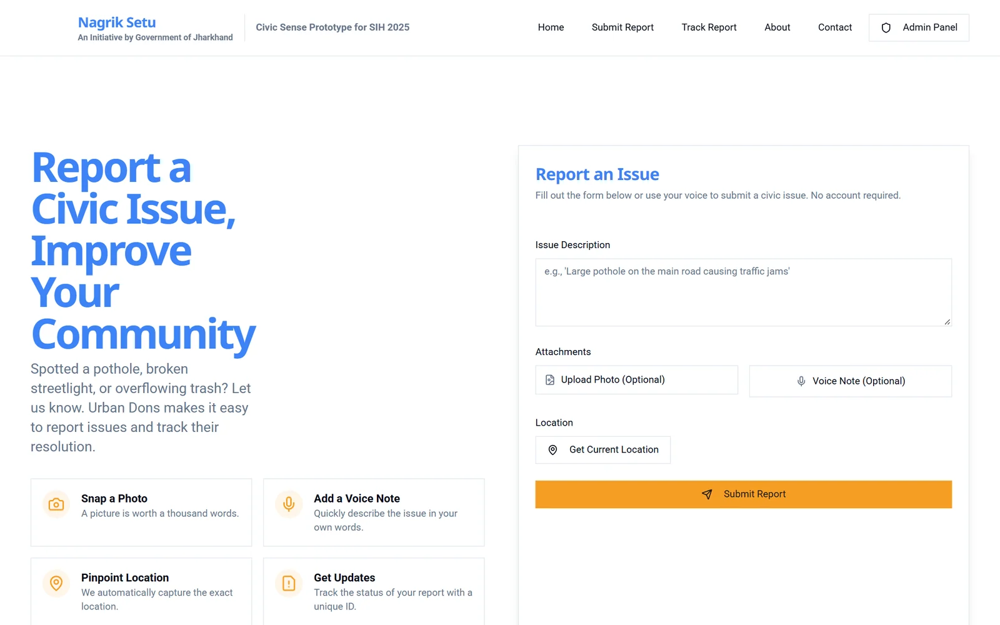
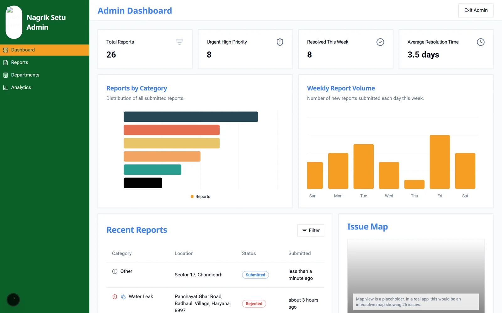
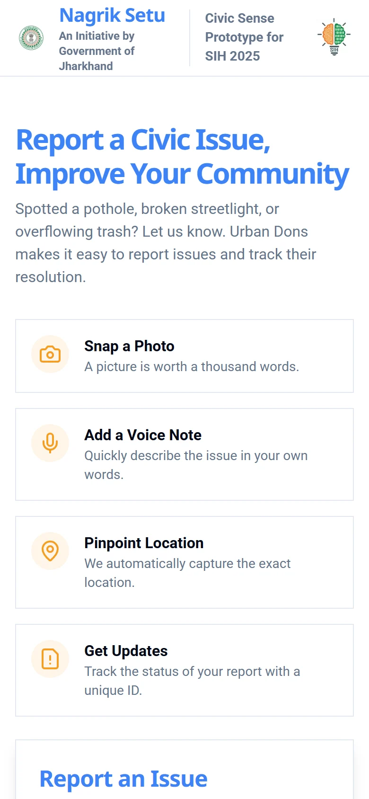

<div align="center">

# Nagrik Setu

**A civic issue reporting platform for Jharkhand: citizens report potholes, broken streetlights and water leaks in seconds; administrators see, sort and resolve them.**

Smart India Hackathon prototype by Team Urban Dons



</div>

## What it does

*Nagrik Setu* means "citizen's bridge". It has two sides:

**For citizens**
- Report an issue without creating an account: a description, an optional photo and an optional voice note.
- The device's GPS location is attached automatically.
- Every report gets a tracking ID, so you can follow it from *Submitted* to *Resolved* on the Track page.

**For administrators**
- A dashboard with total reports, urgent and high-priority counts, issues resolved this week and average resolution time.
- Reports by category, weekly report volume, recent reports and an issue map.
- Filter by status, category or urgency, and update the status of each report.

## Screens

<table>
  <tr>
    <td width="65%"></td>
    <td width="35%" align="center"></td>
  </tr>
  <tr>
    <td><b>Admin dashboard.</b> Totals, reports by category, weekly volume, recent reports and the issue map.</td>
    <td><b>Mobile.</b> The citizen flow is built phone-first.</td>
  </tr>
</table>

## AI categorisation

`src/ai/flows/intelligent-report-categorization.ts` is a Genkit flow on Google Gemini that reads a report's description, assigns a category (Pothole, Water Leak, …) and judges its urgency. In the current prototype, `submitReport` in `src/app/actions.ts` returns a fixed demo report instead of calling the flow, and the address lookup and photo upload are mocked too.

## Tech stack

Next.js (App Router), React, TypeScript, Tailwind CSS, shadcn/ui, Genkit with Google AI. Set up for Firebase App Hosting (`apphosting.yaml`).

## Run locally

Requires Node 18+.

```bash
npm install
echo GEMINI_API_KEY=your_key > .env
npm run dev              # http://localhost:3000
npm run genkit:dev       # optional: Genkit developer UI for the AI flow
```

## Project structure

```
src/
  app/          Next.js routes: / (report), /track, /admin, plus server actions
  ai/           Genkit configuration and flows
  components/   shadcn/ui and app components
  lib/          data store, types, utilities
  hooks/        custom React hooks
```

## Team Urban Dons

| Name | Role |
|---|---|
| Chandan | Team lead, backend engineer |
| Pranjal | Core developer, security and DevOps |
| Ishita | UI/UX designer, frontend developer |
| Kirti | AI specialist |
| Krish | Mobile app developer |
| Aditya | UI/UX design |
